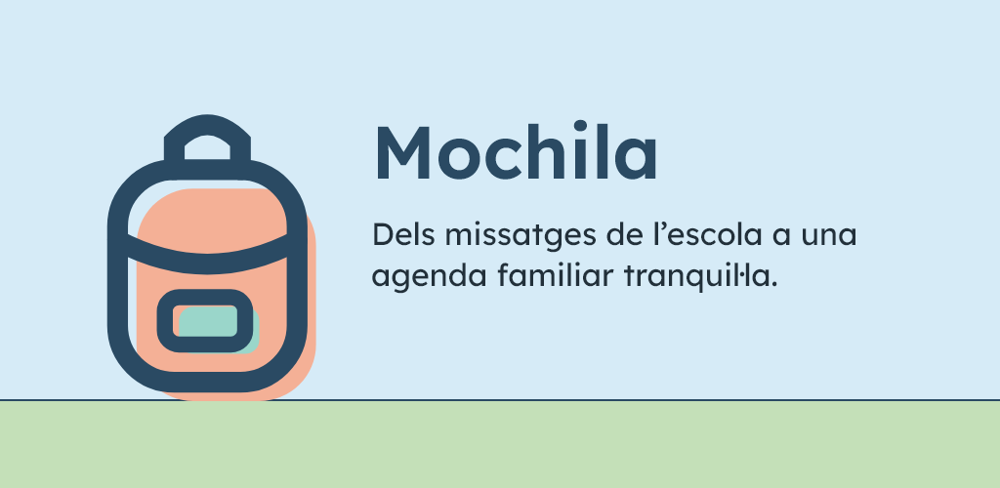
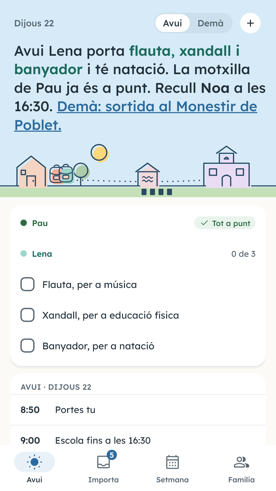
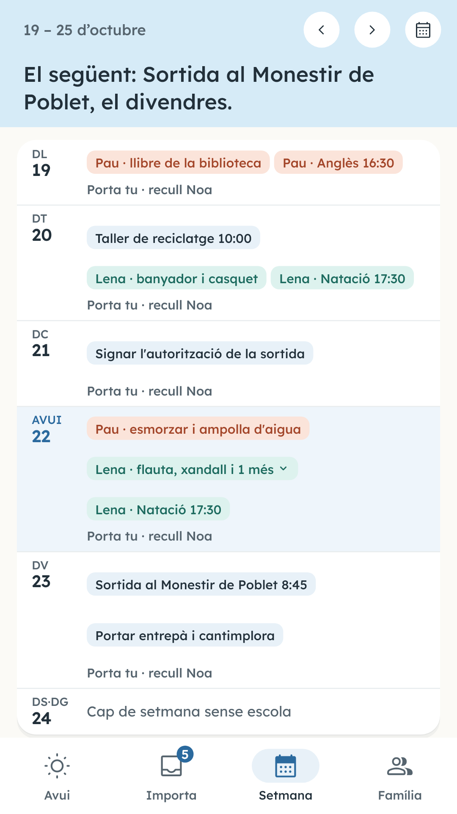
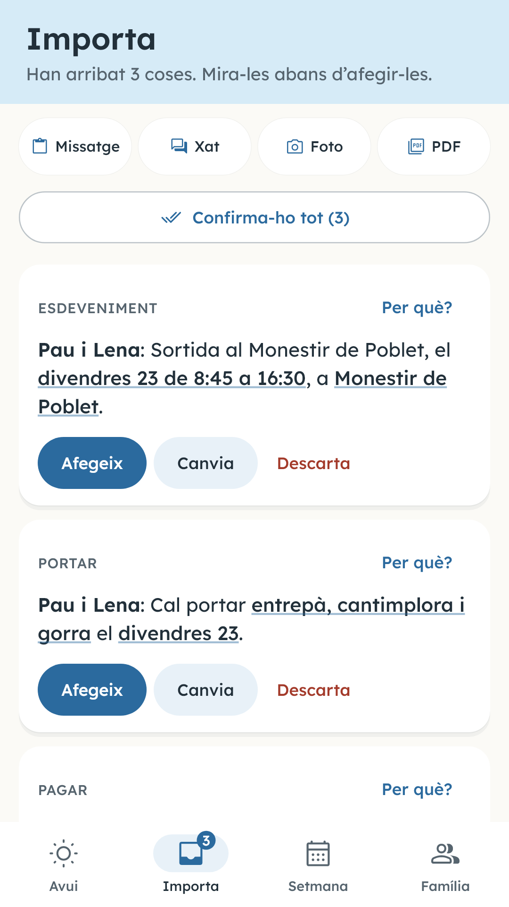
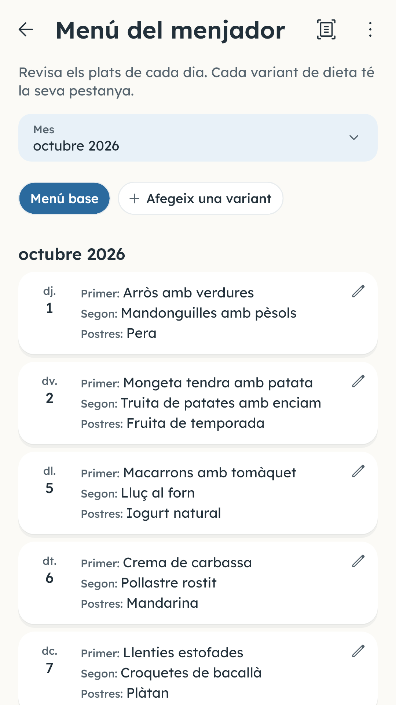
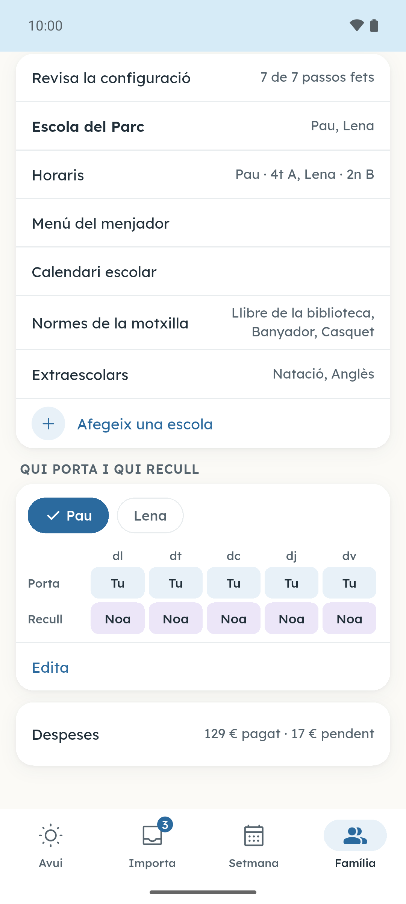
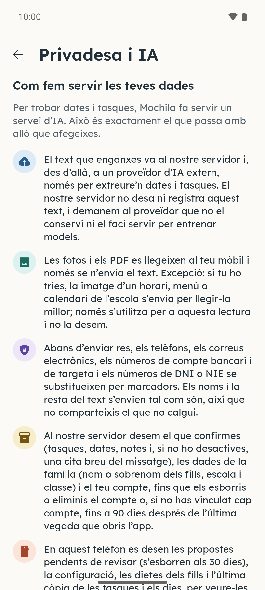
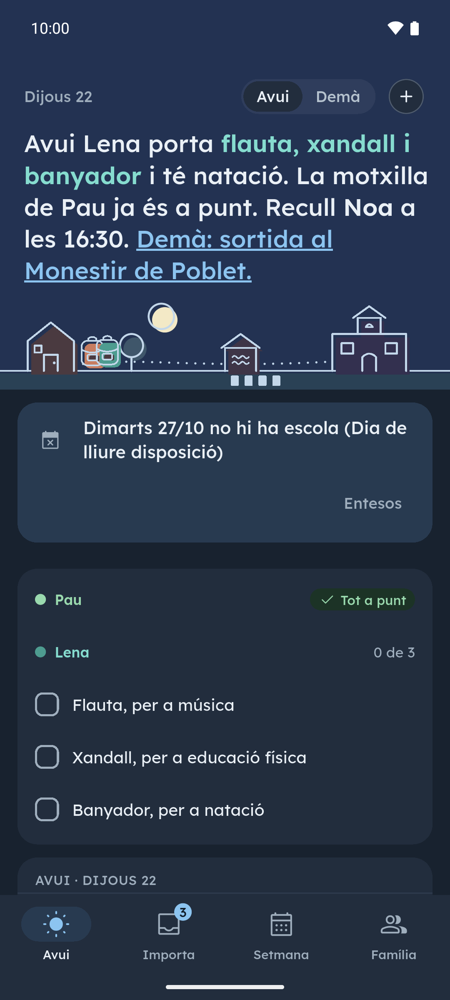

[English](README.md) · [Español](README.es.md) · **Català** · [Galego](README.gl.md) · [Euskara](README.eu.md)

  

# Mochila

Mochila converteix els avisos de l’escola en l’agenda de la família. Copia el missatge del grup de classe i enganxa’l a Mochila, o dona-li una foto o un PDF d’una circular, del menú del menjador o de l’horari: l’app en treu què cal portar, qui recull, les extraescolars i els pagaments, cada cosa al seu dia, i tu ho revises tot abans que entri a l’agenda. Mochila no entra als teus grups de WhatsApp: només llegeix el que tu copies.

**Gratuïta durant el llançament · Sense anuncis · Compte opcional**

## Baixades

  
  
  <!--
  
  -->

Android: prova tancada a Google Play, oberta a qui s’uneixi al grup de provadors; la baixada s’obre tan bon punt Google aprovi la prova. iPhone: properament. Al web també hi ha una demo amb tres avisos d’exemple: [lamochila.app](https://lamochila.app/ca/).

Uneix-te a la beta de Google Play

Fes els dos passos amb el compte de Google que fas servir al mòbil Android.

1. Uneix-te al grup de Google [mochila-testers](https://groups.google.com/g/mochila-testers).
2. Obre la [pàgina de la prova a Google Play](https://play.google.com/apps/testing/es.lamochila.app), apunta’t com a provador i instal·la Mochila des de Google Play.

Si la pàgina diu que la prova no està disponible, Google encara la revisa: torna-ho a provar d’aquí a uns dies.

Gratuïta durant el llançament

Durant el llançament, Mochila és gratuïta i no té anuncis. Pots començar sense crear cap compte: sense compte, la teva família pot fer fins a 3 anàlisis al dia i 20 al mes (cada avís que llegeix Mochila compta com una anàlisi). Si vincules un compte gratuït de Google o Apple, pots convidar l’altre adult per compartir l’agenda, arribar a 20 anàlisis al dia i 200 al mes per família, i no en perds l’accés si canvies de telèfon.

## Captures

  
  
  
  
  

Més captures

  
  

Prem una captura per ampliar-la. Pantalles reals amb dades inventades.

## Funcions

- **Avui, d’un cop d’ull.** Què porta cada fill, què toca a l’escola i què venç; a la tarda ja ensenya l’endemà.
- **Tu decideixes.** Mochila proposa la data, l’hora, el fill i el que cal portar, pagar o signar, i tu confirmes, canvies o descartes cada cosa.
- **Compartida amb l’altre adult.** El convides amb un codi i tots dos veieu el mateix: dates, tasques, la motxilla i qui recull.
- **Calendari escolar inclòs.** El calendari oficial de la teva comunitat i els festius del teu municipi ja hi són, i hi pots afegir els dies de lliure disposició de la teva escola.
- **Horari i menú del menjador.** L’horari de cada fill i el menú del menjador, llegits d’una foto o d’un PDF.
- **Resum de cada vespre.** Cada vespre et recorda què cal portar, pagar i signar l’endemà.

Més funcions

- **Widget a la pantalla d’inici.** Què cal portar avui i demà, sense obrir l’app.
- **El teu calendari.** El que confirmes pot anar al calendari del mòbil.
- **Extraescolars i pagaments.** Les extraescolars i els pagaments de l’escola per fill i trimestre, que pots exportar a CSV.
- **Cinc idiomes.** Català, español, English, euskara i galego, amb mode clar i fosc, cinc gammes de color i un color per a cada fill.

## Privacitat

Les fotos i els PDF es llegeixen al telèfon i només se n’envia el text; si tries una lectura més precisa d’un horari, un menú o un calendari de l’escola, la imatge s’envia només per a aquella lectura i no es desa. Abans d’enviar res, el teu mòbil substitueix els telèfons i els correus per marcadors, i el text del missatge no es desa sencer al servidor: s’hi desen els elements que confirmes i, si no ho desactives, una cita breu. Dels fills només es desa el nom o el sobrenom, l’escola i la classe; mai els cognoms.

[Política de privadesa](https://lamochila.app/ca/privacitat) · [Eliminar el compte](https://lamochila.app/eliminar-cuenta)

## Novetats

Novetats de cada versió (en anglès): [CHANGELOG.md](CHANGELOG.md).

## Comentaris

[Obre una incidència](https://github.com/dferrandizmont/mochila/issues) o escriu a **hola@lamochila.app**. Si us plau, no hi enganxis missatges reals de l’escola, dades dels fills, telèfons ni correus.

Per a avisos de seguretat: [SECURITY.md](SECURITY.md).

## Llicència

L’app es pot fer servir de franc, però el seu codi no és públic: necessita un servidor que llegeix els missatges. Aquest repositori guarda la informació, les notes de cada versió i les incidències.

Consulta [LICENSE](LICENSE).
