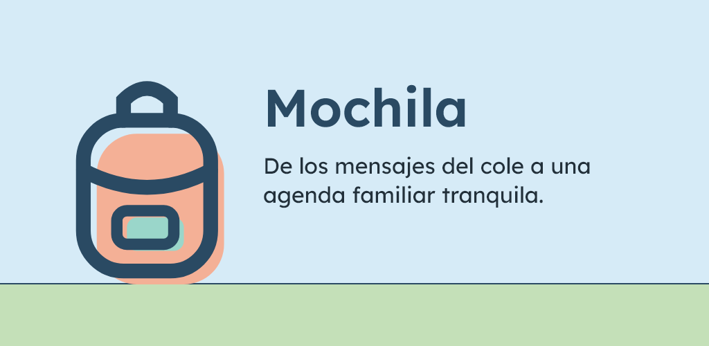
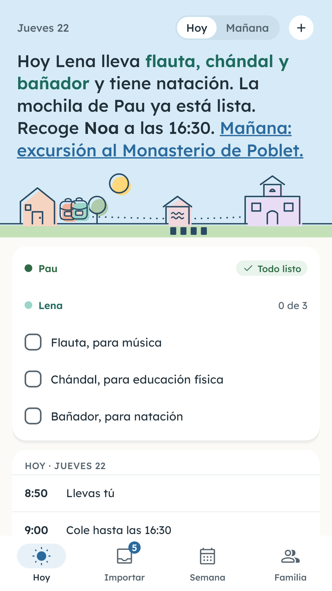
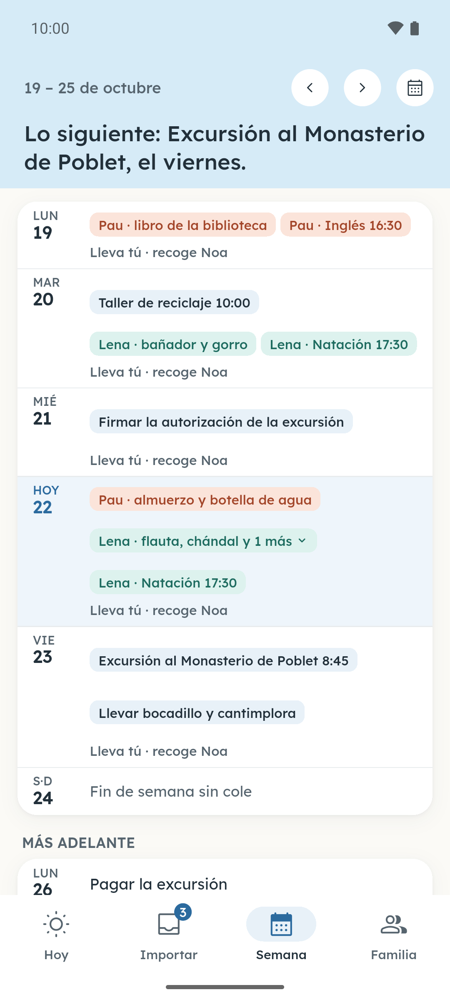
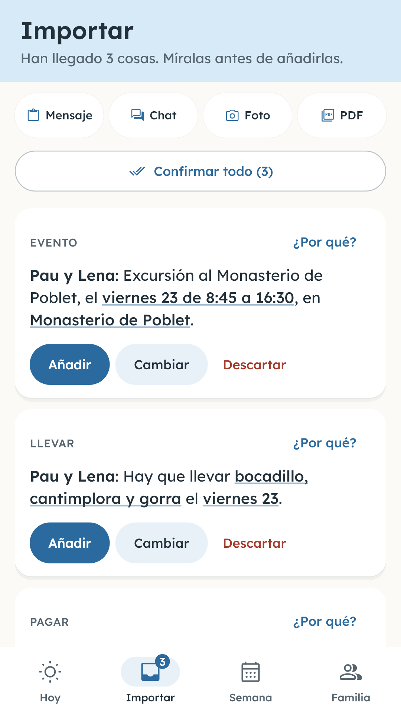
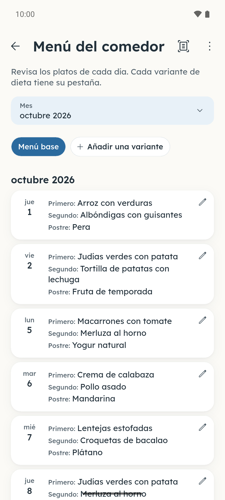
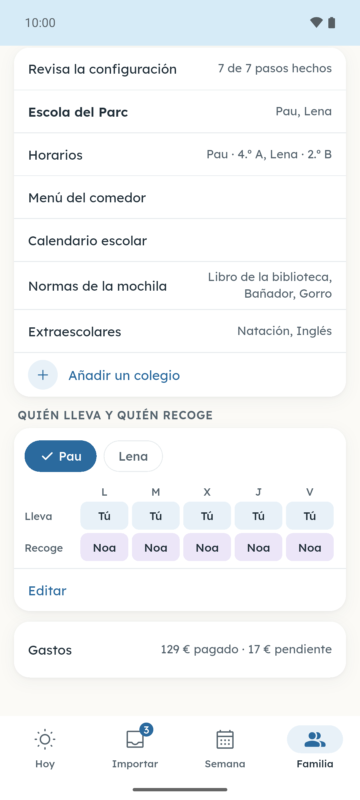
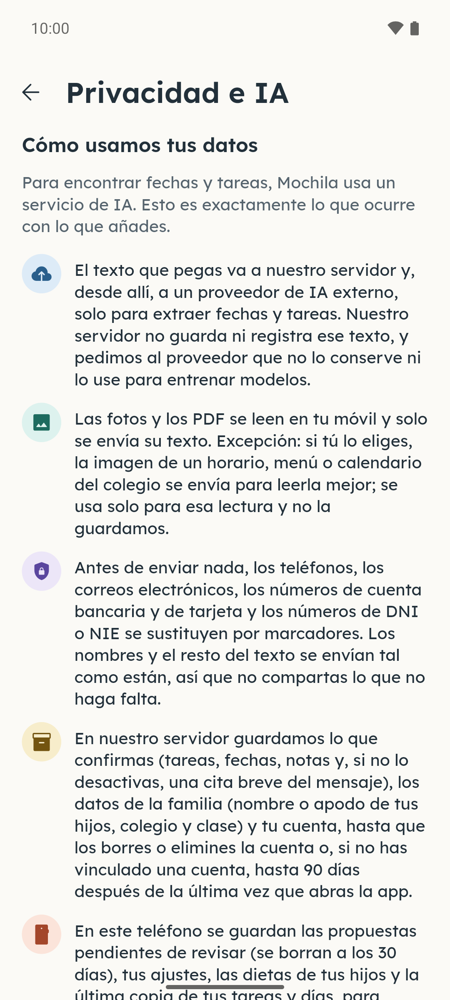
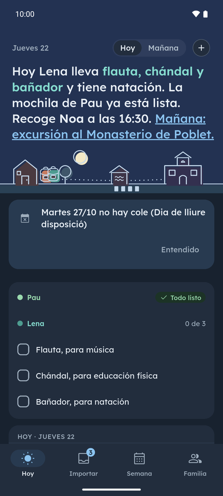

[English](README.md) · **Español** · [Català](README.ca.md) · [Galego](README.gl.md) · [Euskara](README.eu.md)

  

# Mochila

Mochila convierte los avisos del cole en la agenda de la familia. Copia el mensaje del grupo de clase y pégalo en Mochila, o dale una foto o un PDF de una circular, del menú del comedor o del horario: la app saca qué hay que llevar, quién recoge, las extraescolares y los pagos, cada cosa en su día, y tú lo revisas todo antes de que entre en la agenda. Mochila no entra en tus grupos de WhatsApp: solo lee lo que tú copias.

**Gratis durante el lanzamiento · Sin anuncios · Cuenta opcional**

## Descargas

  
  
  <!--
  
  -->

Android: prueba cerrada en Google Play, abierta a quien se una al grupo de probadores. iPhone: próximamente. En la web también hay una demo con tres avisos de ejemplo: [lamochila.app](https://lamochila.app).

Únete a la beta de Google Play

Haz los dos pasos con la cuenta de Google que usas en el móvil Android.

1. Únete al grupo de Google [mochila-testers](https://groups.google.com/g/mochila-testers).
2. Abre la [página de la prueba en Google Play](https://play.google.com/apps/testing/es.lamochila.app), apúntate como probador e instala Mochila desde Google Play.

Gratis durante el lanzamiento

Durante el lanzamiento, Mochila es gratis y no tiene anuncios. Puedes empezar sin crear una cuenta: sin cuenta, tu familia puede hacer hasta 3 análisis al día y 20 al mes (cada aviso que lee Mochila cuenta como un análisis). Si vinculas una cuenta gratuita de Google o Apple, puedes invitar al otro adulto para compartir la agenda, llegar a 20 análisis al día y 200 al mes por familia, y no pierdes el acceso si cambias de teléfono.

## Capturas

  
  
  
  
  

Más capturas

  
  

Pulsa una captura para ampliarla. Pantallas reales con datos inventados.

## Funciones

- **Hoy, de un vistazo.** Qué lleva cada hijo, qué toca en el cole y qué vence; por la tarde ya enseña el día siguiente.
- **Tú decides.** Mochila propone la fecha, la hora, el hijo y lo que hay que llevar, pagar o firmar, y tú confirmas, cambias o descartas cada cosa.
- **Compartida con el otro adulto.** Lo invitas con un código y los dos veis lo mismo: fechas, tareas, la mochila y quién recoge.
- **Calendario escolar incluido.** El calendario oficial de tu comunidad y los festivos de tu municipio ya vienen puestos, y puedes añadir los días de libre disposición de tu cole.
- **Horario y menú del comedor.** El horario de cada hijo y el menú del comedor, leídos de una foto o de un PDF.
- **Resumen de cada noche.** Cada noche te recuerda qué hay que llevar, pagar y firmar al día siguiente.

Más funciones

- **Widget en la pantalla de inicio.** Qué hay que llevar hoy y mañana, sin abrir la app.
- **Tu calendario.** Lo que confirmas puede ir al calendario del móvil.
- **Extraescolares y pagos.** Las extraescolares y los pagos del cole por hijo y trimestre, que puedes exportar a CSV.
- **Cinco idiomas.** Català, español, English, euskara y galego, con modo claro y oscuro, cinco gamas de color y un color para cada hijo.

## Privacidad

Las fotos y los PDF se leen en el teléfono y solo se envía el texto; si eliges una lectura más precisa de un horario, un menú o un calendario del cole, la imagen se envía solo para esa lectura y no se guarda. Antes de enviar nada, tu móvil sustituye los teléfonos y los correos por marcadores, y el texto del mensaje no se guarda entero en el servidor: se guardan los elementos que confirmas y, si no lo desactivas, una cita breve. De los hijos solo se guarda el nombre o el apodo, el cole y la clase; nunca los apellidos.

[Política de privacidad](https://lamochila.app/privacidad) · [Eliminar la cuenta](https://lamochila.app/eliminar-cuenta)

## Novedades

Novedades de cada versión (en inglés): [CHANGELOG.md](CHANGELOG.md).

## Comentarios

[Abre una incidencia](https://github.com/dferrandizmont/mochila/issues) o escribe a **hola@lamochila.app**. Por favor, no pegues mensajes reales del cole, datos de los hijos, teléfonos ni correos.

Para avisos de seguridad: [SECURITY.md](SECURITY.md).

## Licencia

La app se puede usar gratis, pero su código no es público: necesita un servidor que lee los mensajes. Este repositorio guarda la información, las notas de cada versión y las incidencias.

Ver [LICENSE](LICENSE).
