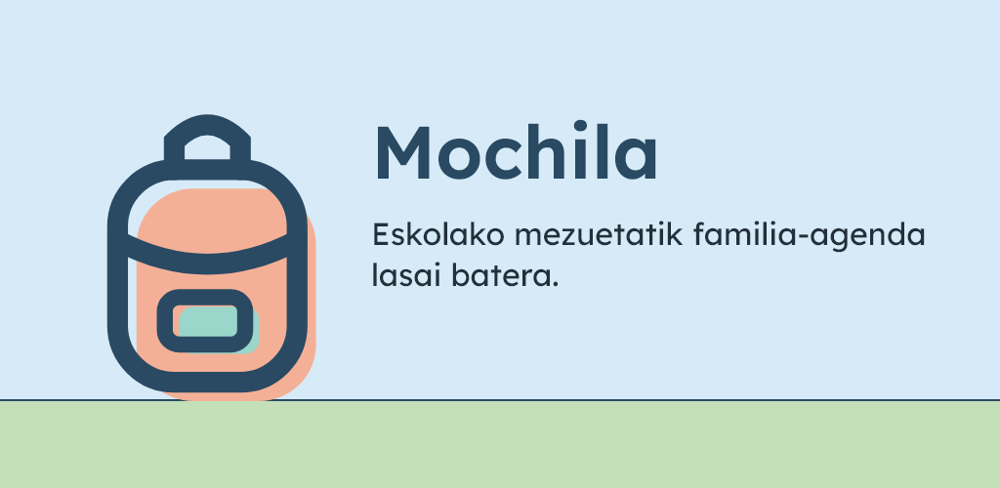
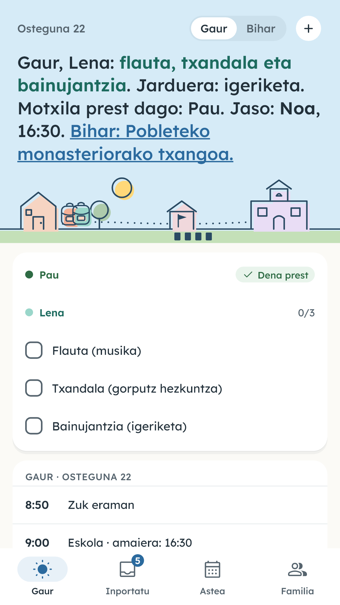
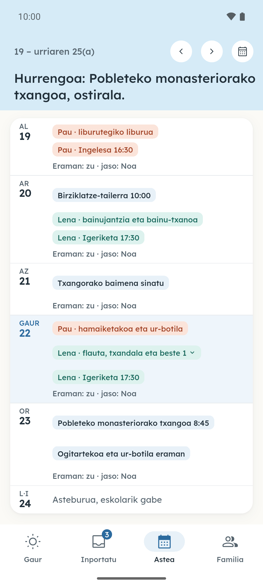
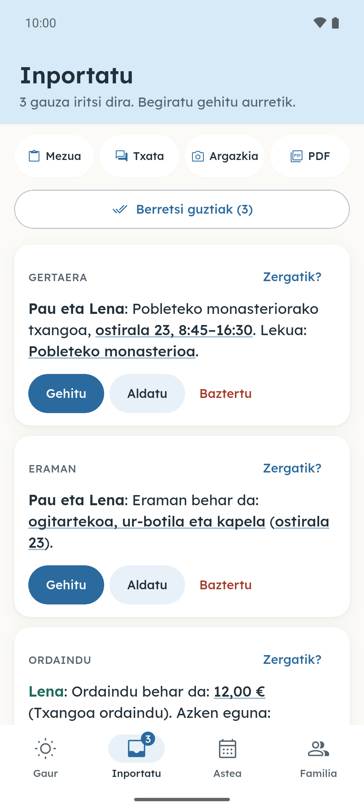
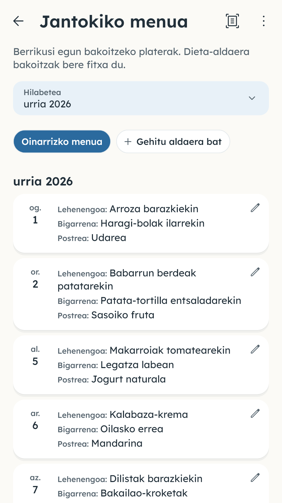
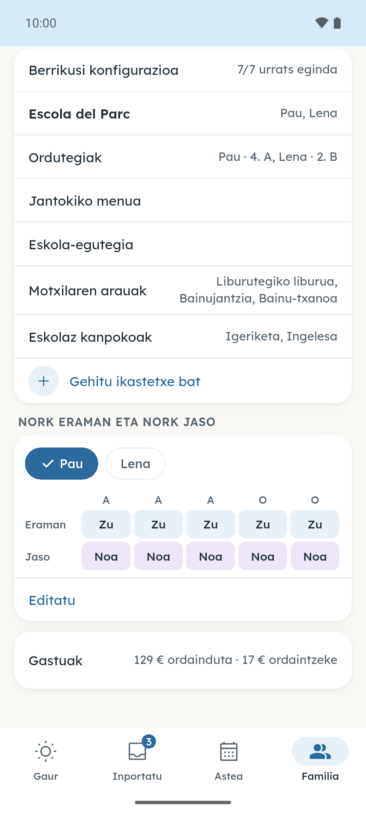
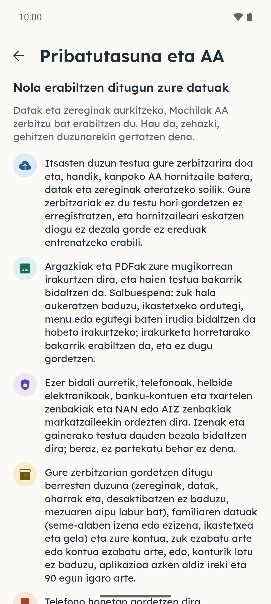
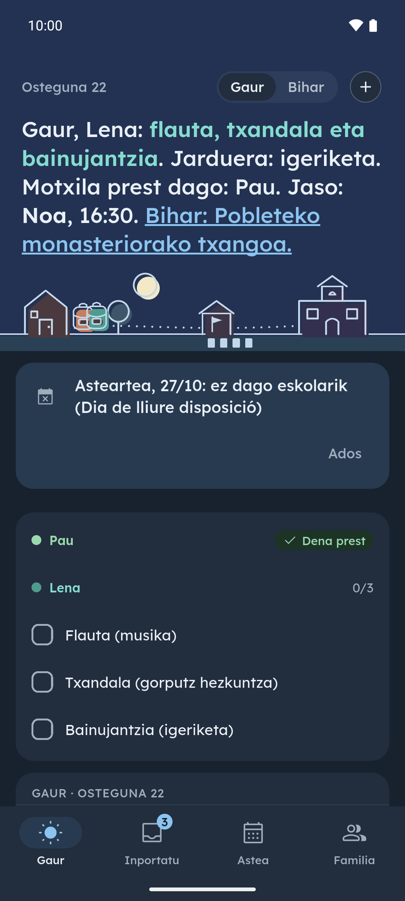

[English](README.md) · [Español](README.es.md) · [Català](README.ca.md) · [Galego](README.gl.md) · **Euskara**

  

# Mochila

Mochilak eskolako oharrak familiaren agenda bihurtzen ditu. Kopiatu gelako taldeko mezua eta itsatsi Mochilan, edo eman zirkular baten, jantokiko menuaren edo ordutegiaren argazkia edo PDFa: aplikazioak zer eraman, nork jaso, eskolaz kanpoko jarduerak eta ordainketak ateratzen ditu, gauza bakoitza bere egunean, eta zuk dena berrikusten duzu agendan sartu aurretik. Mochila ez da zure WhatsApp taldeetan sartzen: zuk kopiatzen duzuna bakarrik irakurtzen du.

**Doan hasierako aldi honetan · Iragarkirik gabe · Kontua aukerakoa da**

## Deskargak

  
  
  <!--
  
  -->

Android: proba itxia Google Play-n, probatzaileen taldean sartzen den edonorentzat; Google-k proba onartu bezain laster irekiko da deskarga. iPhone: laster. Webgunean demo bat ere badago, asmatutako hiru oharrekin: [lamochila.app](https://lamochila.app/eu/).

Sartu Google Play-ko betan

Egin bi urratsak Android mugikorrean erabiltzen duzun Google kontuarekin.

1. Sartu [mochila-testers](https://groups.google.com/g/mochila-testers) Google taldean.
2. Ireki [probaren orria Google Play-n](https://play.google.com/apps/testing/es.lamochila.app), eman izena probatzaile gisa eta instalatu Mochila Google Play-tik.

Orriak proba ez dagoela erabilgarri esaten badu, Google oraindik berrikusten ari da: saiatu berriro egun batzuk barru.

Doan hasierako aldi honetan

Hasierako aldi honetan, Mochila doakoa da eta ez du iragarkirik. Kontu bat sortu gabe has zaitezke: konturik gabe, zure familiak gehienez 3 analisi egin ditzake egunean eta 20 hilean (Mochilak irakurtzen duen ohar bakoitza analisi bat da). Google edo Apple doako kontu bat lotzen baduzu, beste heldua gonbida dezakezu agenda partekatzeko, familia bakoitzeko gehienez 20 analisi egunean eta 200 hilean egin ditzakezu, eta ez duzu sarbidea galduko telefonoa aldatzen baduzu.

## Pantaila-argazkiak

  
  
  
  
  

Pantaila-argazki gehiago

  
  

Sakatu pantaila-argazki bat handitzeko. Benetako pantailak dira, asmatutako datuekin.

## Funtzioak

- **Gaur, begirada batean.** Seme-alaba bakoitzak zer daraman, zer duen eskolan eta zeren epea amaitzen den; arratsaldean hurrengo eguna erakusten du jada.
- **Zuk erabakitzen duzu.** Mochilak data, ordua, seme-alaba eta eraman, ordaindu edo sinatu beharrekoa proposatzen ditu, eta zuk gauza bakoitza berretsi, aldatu edo baztertzen duzu.
- **Beste helduarekin partekatua.** Kode baten bidez gonbidatzen duzu, eta gauza bera ikusten duzue: datak, zereginak, motxila eta nork jasoko duen.
- **Eskola-egutegia barne.** Zure erkidegoko eskola-egutegi ofiziala eta zure udalerriko jaiegunak jarrita daude, eta ikastetxeak erabakitako egun libreak gehi ditzakezu.
- **Ordutegia eta jantokiko menua.** Seme-alaba bakoitzaren ordutegia eta jantokiko menua, argazki edo PDF batetik irakurrita.
- **Gaueko laburpena.** Gauero gogorarazten dizu hurrengo egunean zer eraman, ordaindu eta sinatu behar den.

Funtzio gehiago

- **Hasierako pantailako widgeta.** Gaur eta bihar zer eraman behar den, aplikazioa ireki gabe.
- **Zure egutegia.** Berresten duzuna mugikorreko egutegian sar daiteke.
- **Jarduerak eta ordainketak.** Eskolaz kanpoko jarduerak eta eskolako ordainketak seme-alabaka eta hiruhilekoka, CSVra esportatzeko aukerarekin.
- **Bost hizkuntza.** Català, español, English, euskara eta galego, modu argiarekin eta ilunarekin, bost kolore-gamarekin eta seme-alaba bakoitzarentzako kolore batekin.

## Pribatutasuna

Argazkiak eta PDFak telefonoan irakurtzen dira, eta testua bakarrik bidaltzen da; ordutegi, menu edo eskola-egutegi bat zehatzago irakurri nahi baduzu, irudia ere bidal dezakezu, irakurketa horretarako bakarrik, eta ez da gordetzen. Ezer bidali aurretik, zure mugikorrak telefonoak eta helbide elektronikoak markatzaileekin ordezten ditu, eta mezuaren testu osoa ez da zerbitzarian gordetzen: berresten dituzun elementuak gordetzen dira eta, desaktibatzen ez baduzu, aipu labur bat. Seme-alabei buruz, izena edo ezizena, ikastetxea eta gela bakarrik gordetzen dira; abizenak, inoiz ez.

[Pribatutasun-politika](https://lamochila.app/privacidad) (gaztelaniaz) · [Ezabatu kontua](https://lamochila.app/eliminar-cuenta)

## Berriak

Bertsio bakoitzeko berrikuntzak (ingelesez): [CHANGELOG.md](CHANGELOG.md).

## Iritziak

[Ireki issue bat](https://github.com/dferrandizmont/mochila/issues) edo idatzi **hola@lamochila.app** helbidera. Mesedez, ez itsatsi eskolako benetako mezurik, seme-alaben daturik, telefonorik edo helbide elektronikorik.

Segurtasun-abisuetarako: [SECURITY.md](SECURITY.md).

## Lizentziak

Aplikazioa doan erabil daiteke, baina kodea ez da publikoa: mezuak irakurtzen dituen zerbitzari bat behar du. Biltegi honetan informazioa, bertsio bakoitzaren oharrak eta arazoen eta proposamenen zerrenda (issues) daude.

Ikusi [LICENSE](LICENSE).
