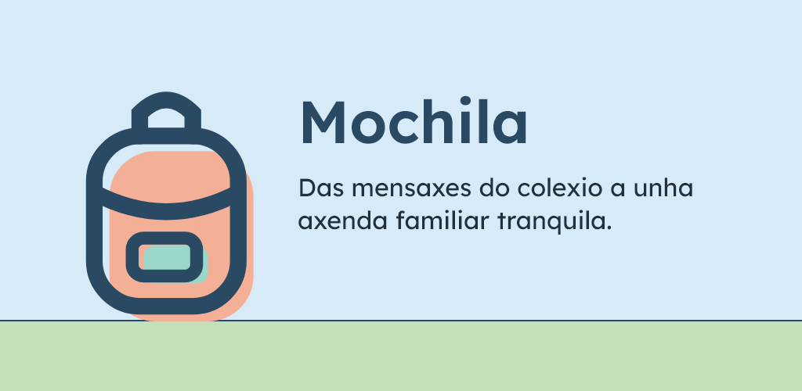
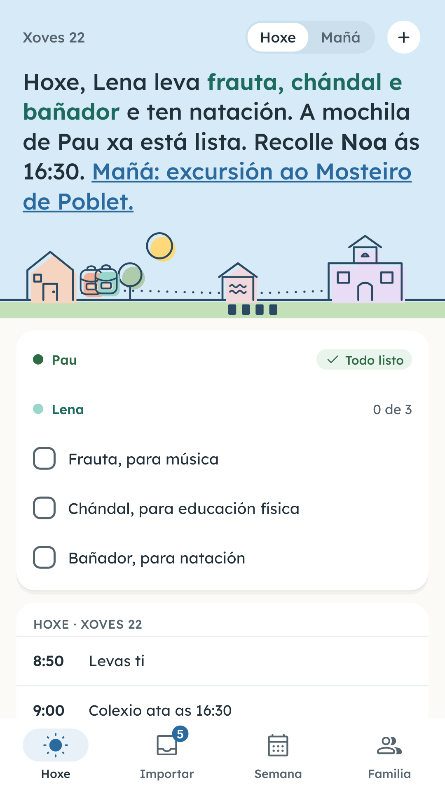
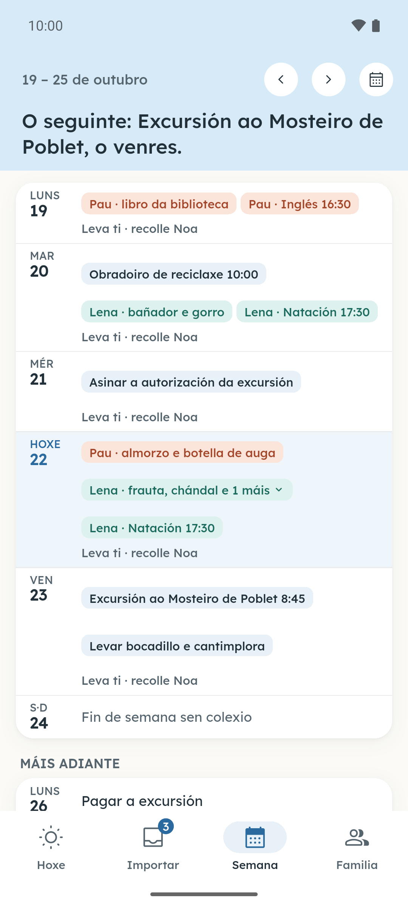
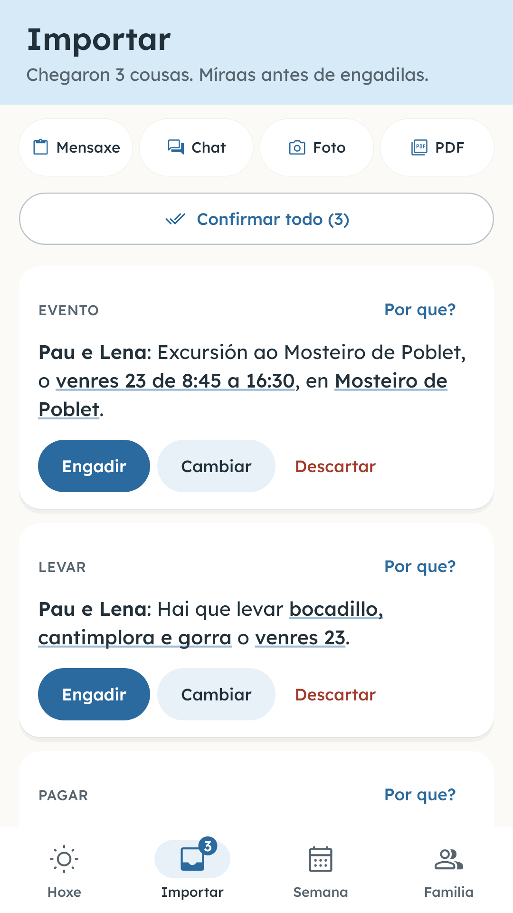
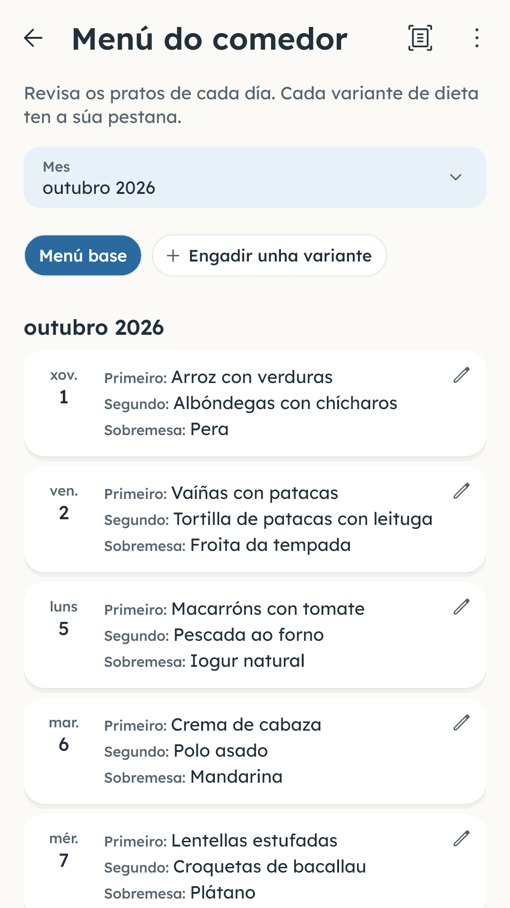
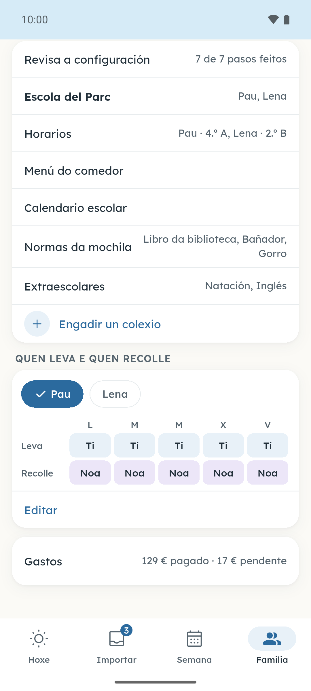
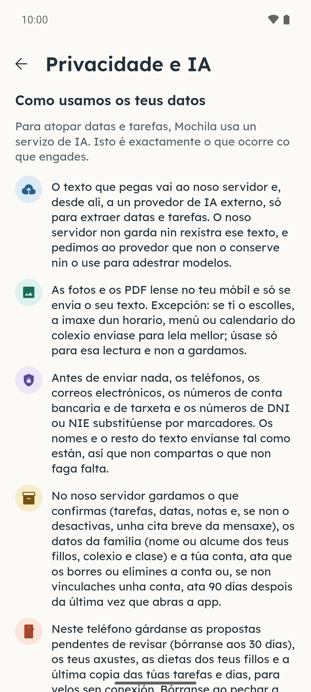
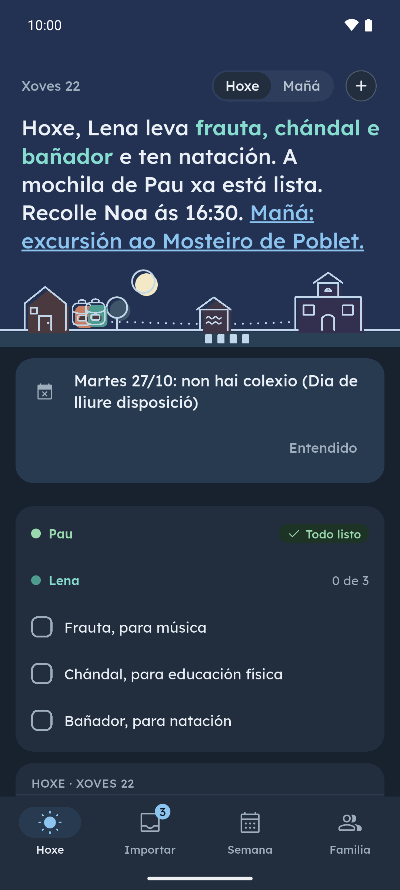

[English](README.md) · [Español](README.es.md) · [Català](README.ca.md) · **Galego** · [Euskara](README.eu.md)

  

# Mochila

Mochila converte os avisos do colexio na axenda da familia. Copia a mensaxe do grupo da clase e pégaa en Mochila, ou dálle unha foto ou un PDF dunha circular, do menú do comedor ou do horario: a app saca que hai que levar, quen recolle, as extraescolares e os pagamentos, cada cousa no seu día, e ti revísalo todo antes de que entre na axenda. Mochila non entra nos teus grupos de WhatsApp: só le o que ti copias.

**De balde durante o lanzamento · Sen anuncios · Conta opcional**

## Descargas

  
  
  <!--
  
  -->

Android: proba pechada en Google Play, aberta a quen se una ao grupo de probadores; a descarga ábrese en canto Google aprobe a proba. iPhone: proximamente. Na web tamén hai unha demo con tres avisos de exemplo: [lamochila.app](https://lamochila.app/gl/).

Únete á beta de Google Play

Fai os dous pasos coa conta de Google que usas no móbil Android.

1. Únete ao grupo de Google [mochila-testers](https://groups.google.com/g/mochila-testers).
2. Abre a [páxina da proba en Google Play](https://play.google.com/apps/testing/es.lamochila.app), apúntate como probador e instala Mochila desde Google Play.

Se a páxina di que a proba non está dispoñible, Google aínda a está revisando: volve probar dentro duns días.

De balde durante o lanzamento

Durante o lanzamento, Mochila é gratuíta e non ten anuncios. Podes comezar sen crear unha conta: sen conta, a túa familia pode facer ata 3 análises ao día e 20 ao mes (cada aviso que le Mochila conta como unha análise). Se vinculas unha conta gratuíta de Google ou Apple, podes convidar o outro adulto para compartir a axenda, chegar a 20 análises ao día e 200 ao mes por familia, e non perdes o acceso se cambias de teléfono.

## Capturas

  
  
  
  
  

Máis capturas

  
  

Preme unha captura para ampliala. Pantallas reais con datos inventados.

## Funcións

- **Hoxe, dunha ollada.** Que leva cada fillo, que toca no colexio e que vence; pola tarde xa amosa o día seguinte.
- **Ti decides.** Mochila propón a data, a hora, o fillo e o que hai que levar, pagar ou asinar, e ti confirmas, cambias ou descartas cada cousa.
- **Compartida co outro adulto.** Convídalo cun código e os dous vedes o mesmo: datas, tarefas, a mochila e quen recolle.
- **Calendario escolar incluído.** O calendario oficial da túa comunidade e os festivos do teu concello xa veñen postos, e podes engadir os días de libre disposición do teu colexio.
- **Horario e menú do comedor.** O horario de cada fillo e o menú do comedor, lidos dunha foto ou dun PDF.
- **Resumo da noite.** Cada noite lémbrache que hai que levar, pagar e asinar ao día seguinte.

Máis funcións

- **Widget na pantalla de inicio.** Que hai que levar hoxe e mañá, sen abrir a app.
- **O teu calendario.** O que confirmas pode ir ao calendario do móbil.
- **Extraescolares e pagamentos.** As extraescolares e os pagamentos do colexio por fillo e trimestre, que podes exportar a CSV.
- **Cinco idiomas.** Català, español, English, euskara e galego, con modo claro e escuro, cinco gamas de cor e unha cor para cada fillo.

## Privacidade

As fotos e os PDF lense no teléfono e só se envía o texto; se escolles unha lectura máis precisa dun horario, un menú ou un calendario do colexio, a imaxe envíase só para esa lectura e non se garda. Antes de enviar nada, o teu móbil substitúe os teléfonos e os correos por marcadores, e o texto da mensaxe non se garda enteiro no servidor: gárdanse os elementos que confirmas e, se non o desactivas, unha cita breve. Dos fillos só se garda o nome ou o alcume, o colexio e a clase; nunca os apelidos.

[Política de privacidade](https://lamochila.app/privacidad) (en castelán) · [Eliminar a conta](https://lamochila.app/eliminar-cuenta)

## Novidades

Novidades de cada versión (en inglés): [CHANGELOG.md](CHANGELOG.md).

## Comentarios

[Abre unha incidencia](https://github.com/dferrandizmont/mochila/issues) ou escribe a **hola@lamochila.app**. Por favor, non pegues mensaxes reais do colexio, datos dos fillos, teléfonos nin correos.

Para avisos de seguridade: [SECURITY.md](SECURITY.md).

## Licenzas

A app pódese usar de balde, pero o seu código non é público: necesita un servidor que le as mensaxes. Este repositorio garda a información, as notas de cada versión e as incidencias.

Consulta [LICENSE](LICENSE).
