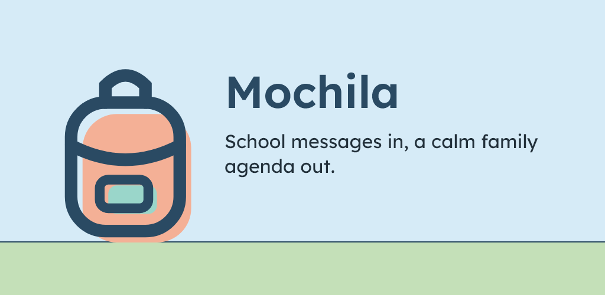
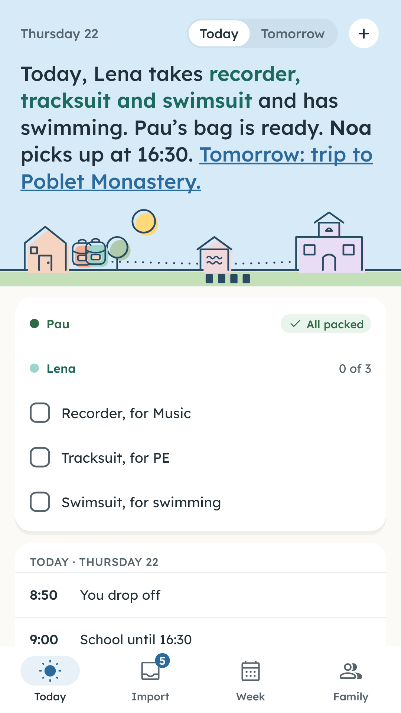
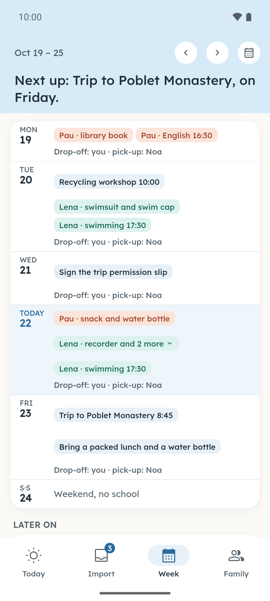
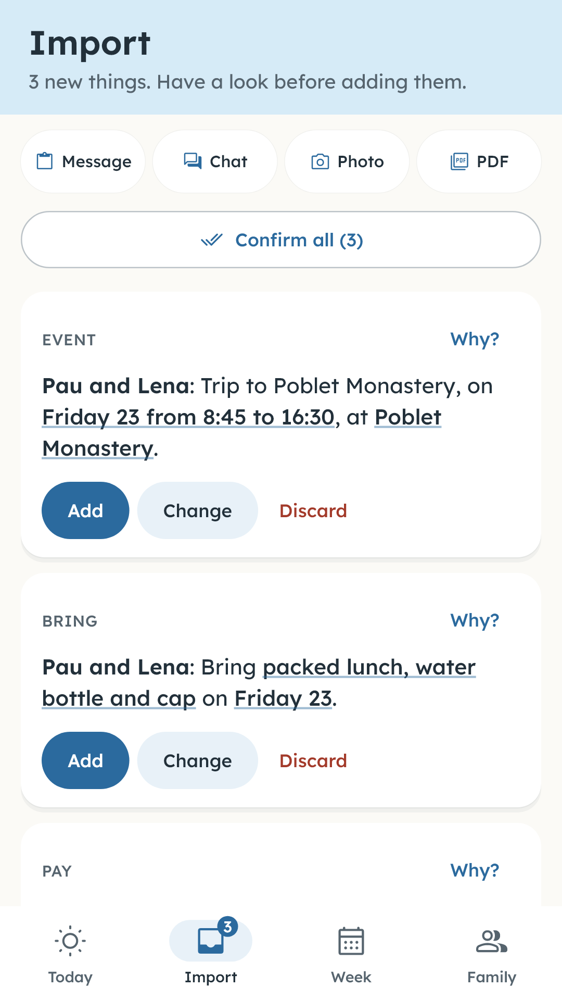
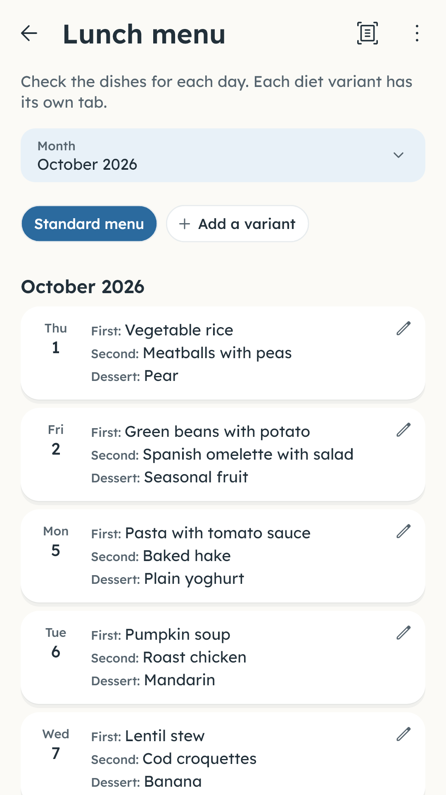
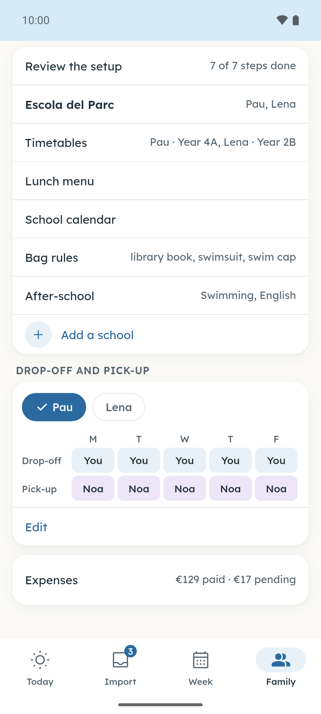
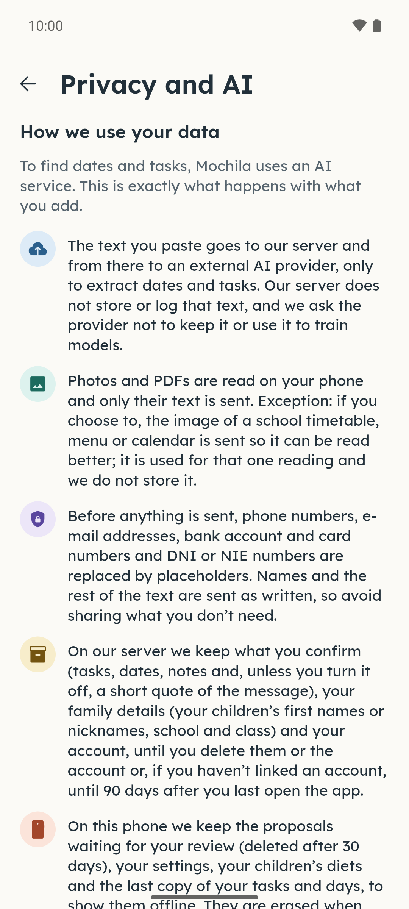
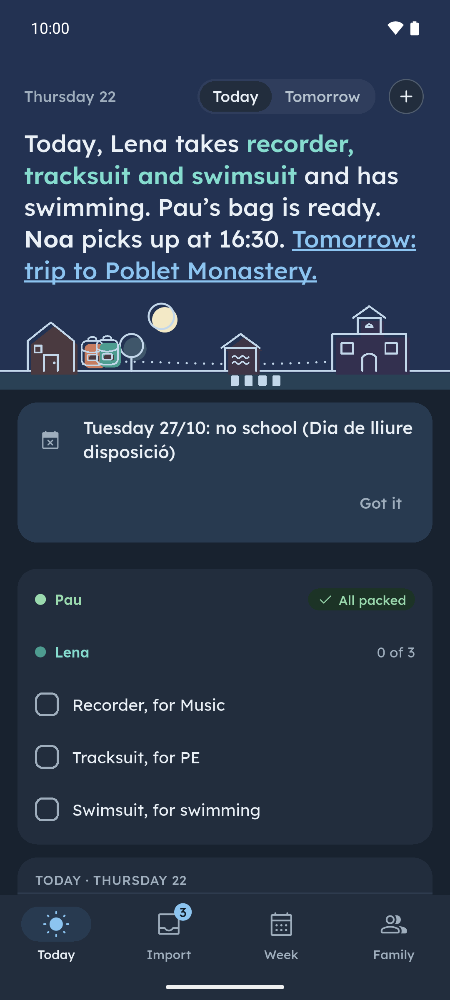

**English** · [Español](README.es.md) · [Català](README.ca.md) · [Galego](README.gl.md) · [Euskara](README.eu.md)

  

# Mochila

Mochila turns school messages into the family agenda. Copy a message from the class group and paste it into Mochila, or give it a photo or a PDF of a school letter, a lunch menu or a timetable: it picks out what to bring, who picks up, the activities and the payments, each on its own day, and you review everything first. The app never goes into your WhatsApp groups: it only reads what you copy.

**Free during the launch · No ads · Account optional**

## Download

  
  
  
  <!--
  
  -->

Android: closed test on Google Play, open to anyone. iPhone: coming soon. The website also has a demo with three example notices: [lamochila.app](https://lamochila.app/en/).

Join the beta on Google Play

Mochila is in closed testing on Google Play and anyone can join:

1. Join the testers group: [mochila-testers](https://groups.google.com/g/mochila-testers). Sign in with the Google account you use on your Android phone and press «Join group».
2. Accept the test from your phone or computer: [play.google.com/apps/testing/es.lamochila.app](https://play.google.com/apps/testing/es.lamochila.app).
3. Install the app from Google Play. It updates itself.

If you can, stay in the test for at least 14 days and use it from time to time (for example, paste a message from school): Google requires 12 testers for 14 days to publish it for everyone. Send comments to hola@lamochila.app.

Install the APK from GitHub

Or download the APK of the [latest release](https://github.com/dferrandizmont/mochila/releases/latest) and install it by hand (allow installs from unknown sources). It uses a different signing key from the Google Play version, so one does not update the other: to switch, uninstall one and install the other. If you sign in with your Google account, your family's data comes back on its own.

Free during the launch

During the launch, Mochila is free and shows no ads. You can start without creating an account: without one, your family can run up to 3 analyses a day and 20 a month (each notice Mochila reads counts as one analysis). If you link a free Google or Apple account, you can invite the other adult to share the agenda, go up to 20 analyses a day and 200 a month per family, and keep access if you change phones.

## Screenshots

  
  
  
  
  

More screenshots

  
  

Tap a screenshot to enlarge it. Real screens with made-up details.

## Features

- **Today at a glance.** What each child takes, what is on at school and what is due; in the afternoon it already shows tomorrow.
- **You have the last word.** Mochila suggests the date, the time, the child and what to bring, pay or sign, and you confirm, edit or discard each item.
- **Shared with the other adult.** Invite them with a code and you both see the same dates, tasks, bag and pickups.
- **School calendar included.** Your region's official school calendar and your town's holidays are already there, and you can add your school's own days off.
- **Timetable and lunch menu.** Each child's timetable and the school lunch menu, read from a photo or a PDF.
- **Evening summary.** Every evening a reminder tells you what to bring, pay and sign the next day.

More features

- **Home screen widget.** What to bring today and tomorrow, without opening the app.
- **Your calendar.** What you confirm can go into the phone's calendar.
- **Activities and payments.** After-school activities and school payments by child and term, which you can export as CSV.
- **Five languages.** Catalan, Spanish, English, Basque and Galician, with light and dark mode, five colour ranges and a colour for each child.

## Privacy

Photos and PDFs are read on your phone and only the text is sent; if you choose a more accurate reading of a timetable, a menu or a school calendar, the image is sent for that reading only and is not stored. Before anything leaves the phone, phone numbers and e-mail addresses are replaced with placeholders, and the full text of a message is not kept on the server: only what you confirm and, unless you turn it off, a short quote. For your children, only a first name or nickname, school and class are stored, never surnames.

[Privacy policy](https://lamochila.app/en/privacy) · [Delete account](https://lamochila.app/eliminar-cuenta)

## What's new

What's new in each version (in English): [CHANGELOG.md](CHANGELOG.md).

## Feedback

[Open an issue](https://github.com/dferrandizmont/mochila/issues) or write to **hola@lamochila.app**. Please do not paste real school messages, children's data, phone numbers or e-mail addresses.

For security issues, see [SECURITY.md](SECURITY.md).

## License

The app is free to use, but its code is not public: it needs a server that reads the messages. This repository holds information, release notes and the issue tracker.

See [LICENSE](LICENSE).
